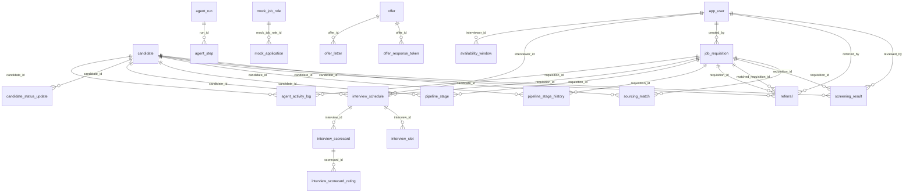

# Database schema

The relational schema behind TalentAcquisition AI, as it stands after Flyway migration **V42** on branch `feature/spring-ai-refactor`. 32 tables.

The column tables below were generated by applying every migration in `backend/src/main/resources/db/migration/h2` in order to an empty H2 database and reading the result back from `INFORMATION_SCHEMA`, so they match what the app runs against. The purpose of each table and the allowed values of the status-like columns come from the code, because the schema itself does not constrain them (see [Conventions](#conventions)).

## Contents

- [Overview](#overview)
- [Conventions](#conventions)
- [Entity-relationship diagram](#entity-relationship-diagram)
- [Users and roles](#users-and-roles): `app_user`, `job_requisition`
- [Candidates and sourcing](#candidates-and-sourcing): `candidate`, `sourcing_match`, `resume_source`, `mock_job_role`, `mock_application`, `candidate_access_log`, `cv_inbox_item`, `cv_inbox_settings`
- [Screening, pipeline and referrals](#screening-pipeline-and-referrals): `screening_result`, `pipeline_stage`, `pipeline_stage_history`, `referral`
- [Interviewing](#interviewing): `interview_schedule`, `interview_slot`, `availability_window`, `interview_scorecard`, `interview_scorecard_rating`, `interview_debrief`, `interview_reminder`
- [Offers](#offers): `offer`, `offer_negotiation_history`, `offer_letter`, `offer_response_token`
- [Agents, notifications and AI governance](#agents-notifications-and-ai-governance): `agent_run`, `agent_step`, `agent_activity_log`, `notification_log`, `candidate_status_update`, `ai_usage_log`, `ai_budget`
- [Relationships that have no foreign key](#relationships-that-have-no-foreign-key)
- [Deletion behaviour](#deletion-behaviour)
- [Migrations](#migrations)
- [Known gaps](#known-gaps)

## Overview

The model is built around three ideas:

1. **A candidate is one person; a pipeline stage is that person's state for one role.** `candidate` holds identity and
   the CV text. Everything that depends on a role (match score, screening result, stage, interviews, offer) is keyed by
   `(candidate_id, requisition_id)`.
2. **Current state is updated in place; history is a separate log.** `pipeline_stage` has one row per candidate and
   role. Every real move is also appended to `pipeline_stage_history`, which is what Application History reads.
3. **Agents leave a trail.** Each Claude call is recorded in `ai_usage_log`, each agent action in `agent_activity_log`,
   each orchestrator run in `agent_run` / `agent_step`, and each email in `notification_log`.

Where a candidate's state lives at each point in the funnel:

| Point in the funnel | Where it is stored |
|---|---|
| Arrives (upload, careers page, job board, SFTP, referral) | `candidate`, plus `sourcing_match` or `referral` |
| Matched and scored by Sourcing | `sourcing_match.match_score` |
| Screened by the Screening Agent | `screening_result` (the score shown for the role) |
| Moves through stages | `pipeline_stage` (now) and `pipeline_stage_history` (every move) |
| Interviewed | `interview_schedule`, `interview_slot`, `interview_scorecard`(+`_rating`), `interview_debrief` |
| Offered | `offer`, `offer_letter`, `offer_response_token`, `offer_negotiation_history` |

## Conventions

- **Names** are `snake_case`; tables are singular.
- **Keys.** Every table has a `bigint` surrogate key `id` generated by the database, except `interview_scorecard_rating`
  (composite key) and the two single-row settings tables, `ai_budget` and `cv_inbox_settings`, whose `id` is assigned.
- **Times** are `timestamp` with no time zone. Defaults marked `now` are set by the database.
- **Large text.** Columns shown as `text` can hold long content (CV text, JSON, email bodies). On H2 they are
  `VARCHAR` with a very large maximum.
- **No database enums or check constraints.** Status-like columns are plain `varchar`. The allowed values listed below
  are the ones the code writes; the database will accept any string.
- **Hibernate** runs with `ddl-auto: validate`: the entities must match this schema, and Flyway is the only thing that changes it.
- **Dialects.** The app runs on H2 in PostgreSQL mode with the `db/migration/h2` scripts. See [Known gaps](#known-gaps) for the PostgreSQL profile.

## Entity-relationship diagram

Declared foreign keys only. Relationships the code relies on but the database does not enforce are listed [further down](#relationships-that-have-no-foreign-key).

## Users and roles

### `app_user`

Everyone who can sign in: recruiters, hiring managers, interviewers and admins.

| Column | Type | Null | Default | Notes |
|---|---|---|---|---|
| `id` | bigint | no |  | **PK** (generated) |
| `username` | varchar(100) | no |  |  |
| `email` | varchar(255) | no |  |  |
| `password_hash` | varchar(255) | no |  | BCrypt hash, never the password. |
| `full_name` | varchar(255) | no |  |  |
| `role` | varchar(50) | no | RECRUITER | `ADMIN`, `RECRUITER`, `HIRING_MANAGER` or `INTERVIEWER`. Drives what each person sees. |
| `created_at` | timestamp | no | now |  |
| `active` | boolean | no | true | Deactivated users cannot sign in but their history stays. |

- **Unique:** (username)
- **Unique:** (email)

### `job_requisition`

An open (or closed) role that candidates are matched, screened and interviewed for.

| Column | Type | Null | Default | Notes |
|---|---|---|---|---|
| `id` | bigint | no |  | **PK** (generated) |
| `title` | varchar(255) | no |  |  |
| `department` | varchar(100) | yes |  |  |
| `location` | varchar(100) | yes |  |  |
| `description` | text | no |  |  |
| `required_skills` | text | yes |  | Free text, comma-separated. Sent to Claude with the description when scoring. |
| `experience_level` | varchar(50) | yes |  |  |
| `status` | varchar(30) | no | OPEN | `OPEN` or closed. Only `OPEN` roles take part in matching and referral routing. |
| `created_by` | bigint | yes |  | FK to `app_user` (no cascade) The recruiter who created it. |
| `created_at` | timestamp | no | now |  |
| `required_interview_rounds` | integer | no | 2 | Completed rounds needed before a candidate may move to `OFFER`. |

## Candidates and sourcing

### `candidate`

One person, whichever way they arrived. Per-role state lives in `pipeline_stage`, not here.

| Column | Type | Null | Default | Notes |
|---|---|---|---|---|
| `id` | bigint | no |  | **PK** (generated) |
| `full_name` | varchar(255) | no |  |  |
| `email` | varchar(255) | yes |  | Indexed, not unique: demo mode allows several people to share an email, and the services look up the earliest match. |
| `phone` | varchar(50) | yes |  |  |
| `source_channel` | varchar(50) | no | MANUAL | How the person first arrived: `MANUAL`, `UPLOAD`, `LINKEDIN`, `DIRECT_APPLY`, `CAREERS_PAGE`, `JOBBOARD`, `SFTP_INBOX`, `REFERRAL`. |
| `resume_text` | text | yes |  | Full text extracted from the CV (PDF/DOCX/plain). Sent to Claude untruncated when screening and scoring. |
| `resume_filename` | varchar(255) | yes |  |  |
| `skills` | text | yes |  | Comma-separated, from LinkedIn/careers-page parsing. |
| `years_experience` | numeric(4,1) | yes |  | One decimal place. |
| `headline` | varchar(255) | yes |  |  |
| `profile_url` | varchar(500) | yes |  |  |
| `created_at` | timestamp | no | now |  |
| `updated_at` | timestamp | no | now |  |

- **Index:** idx_candidate_email (email)
- **Index:** idx_candidate_source_channel (source_channel)

### `sourcing_match`

The Sourcing Agent's (or a direct application's) match of one candidate to one role.

| Column | Type | Null | Default | Notes |
|---|---|---|---|---|
| `id` | bigint | no |  | **PK** (generated) |
| `candidate_id` | bigint | no |  | FK to `candidate` (on delete cascade) |
| `requisition_id` | bigint | no |  | FK to `job_requisition` (on delete cascade) |
| `match_score` | numeric(5,2) | no |  | 0-100, from the Sourcing Agent. Separate from the Screening score. |
| `match_rationale` | text | yes |  |  |
| `is_proactive` | boolean | no | true | `true` when the agent found the candidate; `false` for a direct application. |
| `status` | varchar(30) | no | NEW | `NEW`, `APPLIED`, `REVIEWED`, `OUTREACH_SENT`, `SHORTLISTED`, `REJECTED`. Kept in step with the pipeline stage. |
| `created_at` | timestamp | no | now |  |

- **Unique:** (candidate_id, requisition_id)
- **Index:** idx_sourcing_match_requisition (requisition_id)
- **Index:** idx_sourcing_match_score (match_score)

### `resume_source`

A configured location the app syncs CVs from.

| Column | Type | Null | Default | Notes |
|---|---|---|---|---|
| `id` | bigint | no |  | **PK** (generated) |
| `name` | varchar(255) | no |  |  |
| `url` | varchar(1000) | no |  |  |
| `source_type` | varchar(50) | yes |  |  |
| `active` | boolean | no | true |  |
| `last_sync_at` | timestamp | yes |  |  |
| `last_sync_count` | integer | yes | 0 | How many resumes the last sync brought in. |
| `created_at` | timestamp | no | now |  |

### `mock_job_role`

A role on the built-in mock job board used to demo inbound applications.

| Column | Type | Null | Default | Notes |
|---|---|---|---|---|
| `id` | bigint | no |  | **PK** (generated) |
| `title` | varchar(255) | no |  |  |
| `department` | varchar(100) | yes |  |  |
| `location` | varchar(100) | yes | Kuala Lumpur, Malaysia |  |
| `description` | text | yes |  |  |
| `requirements` | text | yes |  |  |
| `requisition_id` | bigint | yes |  | The real requisition this board posting maps to (no foreign key). |
| `active` | boolean | no | true |  |
| `created_at` | timestamp | no | now |  |
| `company` | varchar(255) | yes |  |  |
| `webhook_url` | varchar(500) | yes |  | Where the mock board posts new applications. |

### `mock_application`

An application submitted on the mock job board before it is forwarded into the app.

| Column | Type | Null | Default | Notes |
|---|---|---|---|---|
| `id` | bigint | no |  | **PK** (generated) |
| `mock_job_role_id` | bigint | yes |  | FK to `mock_job_role` (no cascade) |
| `full_name` | varchar(255) | no |  |  |
| `email` | varchar(255) | no |  |  |
| `headline` | varchar(255) | yes |  |  |
| `skills` | varchar(1000) | yes |  |  |
| `years_experience` | numeric(4,1) | yes |  |  |
| `resume_text` | text | yes |  |  |
| `source_channel` | varchar(50) | no | JOBBOARD | Defaults to `JOBBOARD`. |
| `created_at` | timestamp | no | now |  |

### `candidate_access_log`

Audit trail of who viewed or searched candidate records in the directory.

| Column | Type | Null | Default | Notes |
|---|---|---|---|---|
| `id` | bigint | no |  | **PK** (generated) |
| `username` | varchar(100) | no |  |  |
| `action` | varchar(20) | no |  | `SEARCH` or `VIEW`. |
| `candidate_id` | bigint | yes |  |  |
| `search_text` | varchar(200) | yes |  | The query typed, for `SEARCH`. |
| `result_count` | integer | yes |  | How many records the search returned. |
| `created_at` | timestamp | no | now |  |

- **Index:** idx_candidate_access_candidate (candidate_id)

### `cv_inbox_item`

One CV file picked up from the CV Inbox (SFTP, Google Drive or SharePoint) and what was decided about it.

| Column | Type | Null | Default | Notes |
|---|---|---|---|---|
| `id` | bigint | no |  | **PK** (generated) |
| `file_name` | varchar(500) | no |  |  |
| `candidate_id` | bigint | yes |  | Candidate created or updated from the file (no foreign key). |
| `decision` | varchar(20) | no |  | `CONSIDERED` (best role cleared the high-fit bar) or `EXCLUDED`. `FAILED` files carry an error instead. |
| `status` | varchar(20) | no |  | `PROCESSED` or `FAILED`. |
| `best_requisition_id` | bigint | yes |  | Best-matching role (no foreign key). |
| `best_requisition_title` | varchar(255) | yes |  |  |
| `best_match_score` | numeric(5,2) | yes |  |  |
| `best_rationale` | text | yes |  |  |
| `match_details_json` | text | yes |  | Every role's score and rationale, for the breakdown view. Only the best role is persisted elsewhere. |
| `error_message` | text | yes |  |  |
| `processed_at` | timestamp | no | now |  |
| `created_at` | timestamp | no | now |  |
| `candidate_name` | varchar(255) | yes |  | Snapshot taken at processing time (V28), so the inbox list survives candidate edits or deletion. |
| `candidate_email` | varchar(255) | yes |  |  |
| `archived` | boolean | no | false | Hidden from the main inbox list. |

### `cv_inbox_settings`

Single-row configuration of where the CV Inbox reads from.

| Column | Type | Null | Default | Notes |
|---|---|---|---|---|
| `id` | bigint | no |  | **PK** Always one row. |
| `mode` | varchar(20) | no |  | `EMBEDDED`, `EXTERNAL`, `GOOGLE_DRIVE` or `SHAREPOINT`. |
| `embedded_port` | integer | yes |  |  |
| `embedded_username` | varchar(255) | yes |  |  |
| `embedded_password` | varchar(255) | yes |  | Stored in clear, as entered. Demo configuration only. |
| `external_host` | varchar(255) | yes |  |  |
| `external_port` | integer | yes |  |  |
| `external_username` | varchar(255) | yes |  |  |
| `external_password` | varchar(255) | yes |  | Stored in clear, as entered. Demo configuration only. |
| `external_root_path` | varchar(500) | yes |  |  |
| `proxy_enabled` | boolean | no | false |  |
| `proxy_host` | varchar(255) | yes |  |  |
| `proxy_port` | integer | yes |  |  |
| `updated_at` | timestamp | no | now |  |
| `google_folder_id` | varchar(255) | yes |  |  |
| `google_service_account_json` | text | yes |  | Service-account key, stored in clear. |
| `sharepoint_tenant_id` | varchar(255) | yes |  |  |
| `sharepoint_client_id` | varchar(255) | yes |  |  |
| `sharepoint_client_secret` | varchar(1000) | yes |  | Stored in clear. |
| `sharepoint_folder_link` | varchar(2000) | yes |  |  |

## Screening, pipeline and referrals

### `screening_result`

The Screening Agent's score and recommendation for one candidate against one role. The only candidate score shown in the app for a role.

| Column | Type | Null | Default | Notes |
|---|---|---|---|---|
| `id` | bigint | no |  | **PK** (generated) |
| `candidate_id` | bigint | no |  | FK to `candidate` (on delete cascade) |
| `requisition_id` | bigint | no |  | FK to `job_requisition` (on delete cascade) |
| `overall_score` | numeric(5,2) | no |  | 0-100. |
| `skills_score` | numeric(5,2) | yes |  |  |
| `experience_score` | numeric(5,2) | yes |  |  |
| `culture_fit_score` | numeric(5,2) | yes |  |  |
| `strengths` | text | yes |  |  |
| `gaps` | text | yes |  |  |
| `rationale` | text | yes |  |  |
| `recommendation` | varchar(30) | no |  | `ADVANCE`, `REJECT` or `REVIEW`, from Claude. |
| `is_edge_case` | boolean | no | false | `true` holds the candidate for human review instead of auto-rejecting. |
| `reviewed_by` | bigint | yes |  | FK to `app_user` (no cascade) Recruiter who overrode or confirmed the result. |
| `reviewer_decision` | varchar(30) | yes |  | The recruiter's decision, if any. |
| `reviewer_notes` | text | yes |  |  |
| `created_at` | timestamp | no | now |  |

- **Unique:** (candidate_id, requisition_id)
- **Index:** idx_screening_requisition (requisition_id)
- **Index:** idx_screening_edge_case (is_edge_case)

### `pipeline_stage`

Where a candidate currently is for a role: one row per candidate and role, updated in place. Past moves are in `pipeline_stage_history`.

| Column | Type | Null | Default | Notes |
|---|---|---|---|---|
| `id` | bigint | no |  | **PK** (generated) |
| `candidate_id` | bigint | no |  | FK to `candidate` (on delete cascade) |
| `requisition_id` | bigint | no |  | FK to `job_requisition` (on delete cascade) |
| `stage` | varchar(30) | no | SOURCED | `SOURCED`, `SCREENED`, `SHORTLISTED`, `REFERRAL_MATCHED`, `INTERVIEW_SCHEDULED`, `OFFER`, `HIRED`, `REJECTED`, `NO_SHOW`. |
| `entered_at` | timestamp | no | now | When the candidate entered the current stage. Reset on each real move. |
| `updated_by_agent` | varchar(50) | yes |  | Who made the last move: `HUMAN`, `CANDIDATE`, `ORCHESTRATOR`, or an agent (`SCREENING`, `SOURCING`, `REFERRAL`, `ADMIN`). |
| `notes` | text | yes |  | Reason or context for the current stage (screening summary, rejection reason, booking note). |

- **Unique:** (candidate_id, requisition_id)
- **Index:** idx_pipeline_stage_requisition (requisition_id)
- **Index:** idx_pipeline_stage_stage (stage)

### `pipeline_stage_history`

Append-only log of every stage move, written by a JPA entity listener on `pipeline_stage`.

| Column | Type | Null | Default | Notes |
|---|---|---|---|---|
| `id` | bigint | no |  | **PK** (generated) |
| `candidate_id` | bigint | no |  | FK to `candidate` (on delete cascade) |
| `requisition_id` | bigint | no |  | FK to `job_requisition` (on delete cascade) |
| `from_stage` | varchar(30) | yes |  | Null for the first row of a candidate and role. |
| `to_stage` | varchar(30) | no |  |  |
| `changed_by` | varchar(50) | yes |  | Same values as `pipeline_stage.updated_by_agent`. |
| `notes` | text | yes |  | Recorded only when the note changed together with the stage. |
| `occurred_at` | timestamp | no | now | When the move happened. Backfilled rows (V41, V42) only reconstruct Screened and the current stage. |

- **Index:** idx_stage_history_candidate (candidate_id)

### `referral`

An employee referral. Routing sends it to a role, then the candidate is screened; the Screening score is the only score.

| Column | Type | Null | Default | Notes |
|---|---|---|---|---|
| `id` | bigint | no |  | **PK** (generated) |
| `candidate_id` | bigint | no |  | FK to `candidate` (on delete cascade) |
| `requisition_id` | bigint | yes |  | FK to `job_requisition` (no cascade) The role the referrer picked, if any. |
| `referred_by` | bigint | yes | null | FK to `app_user` (no cascade) Signed-in referrer. Null for public (`/refer`) submissions, which use the `referrer_*` columns. |
| `relationship_notes` | text | yes |  |  |
| `match_score` | numeric(5,2) | yes |  | Unused since referrals stopped carrying their own score. Kept to avoid a migration. |
| `matched_requisition_id` | bigint | yes |  | FK to `job_requisition` (no cascade) The role the referral was routed to: the referrer's pick, or the Referral Agent's choice among open roles. |
| `status` | varchar(30) | no | SUBMITTED | `SUBMITTED`, `MATCHED`, `SCREENING`. |
| `submitted_at` | timestamp | no | now |  |
| `last_updated_at` | timestamp | no | now |  |
| `referrer_name` | varchar(255) | yes |  | Public submissions only. |
| `referrer_position` | varchar(255) | yes |  |  |
| `referrer_email` | varchar(255) | yes |  | Public submissions only. |

- **Index:** idx_referral_status (status)
- **Index:** idx_referral_referred_by (referred_by)

## Interviewing

### `interview_schedule`

One interview round for a candidate and role, from booking link to completion.

| Column | Type | Null | Default | Notes |
|---|---|---|---|---|
| `id` | bigint | no |  | **PK** (generated) |
| `candidate_id` | bigint | no |  | FK to `candidate` (on delete cascade) |
| `requisition_id` | bigint | no |  | FK to `job_requisition` (on delete cascade) |
| `interview_type` | varchar(50) | no | SCREENING | `SCREENING`, `TECHNICAL`, `HR` or `FINAL`. |
| `proposed_slots` | text | yes |  | Slots offered to the candidate. |
| `confirmed_slot` | timestamp | yes |  | The time the candidate booked. |
| `status` | varchar(30) | no | PROPOSED | `PROPOSED` (link sent, awaiting booking), `CONFIRMED`, `COMPLETED`. The code also checks for `CANCELLED`. |
| `notes` | text | yes |  |  |
| `created_at` | timestamp | no | now |  |
| `invitation_email` | text | yes |  | The booking-link email as sent. |
| `candidate_reply` | text | yes |  | Free-text reply from the candidate, if any. |
| `candidate_replied_at` | timestamp | yes |  |  |
| `interviewer_id` | bigint | yes |  | FK to `app_user` (no cascade) Null while unassigned. |

### `interview_slot`

A booked time. The unique constraint stops one interviewer being booked twice at the same start.

| Column | Type | Null | Default | Notes |
|---|---|---|---|---|
| `id` | bigint | no |  | **PK** (generated) |
| `start_time` | timestamp | no |  |  |
| `end_time` | timestamp | no |  |  |
| `interview_id` | bigint | yes |  | FK to `interview_schedule` (no cascade) Interview this slot belongs to. |
| `interviewer_id` | bigint | yes |  | Interviewer whose time is blocked. Null for interviews with no interviewer. |

- **Unique:** (interviewer_id, start_time)

### `availability_window`

A block of time someone has published as free for interviews. Candidates can only book inside these.

| Column | Type | Null | Default | Notes |
|---|---|---|---|---|
| `id` | bigint | no |  | **PK** (generated) |
| `start_time` | timestamp | no |  |  |
| `end_time` | timestamp | no |  |  |
| `interviewer_id` | bigint | yes |  | FK to `app_user` (no cascade) The interviewer it belongs to. Null means open to everyone. Added in V40. |

### `interview_scorecard`

An interviewer's verdict and notes for one interview. One per interview.

| Column | Type | Null | Default | Notes |
|---|---|---|---|---|
| `id` | bigint | no |  | **PK** (generated) |
| `interview_id` | bigint | no |  | FK to `interview_schedule` (no cascade) |
| `verdict` | varchar(20) | no |  | `STRONG_YES`, `YES`, `NO` or `STRONG_NO`. |
| `notes` | text | yes |  |  |
| `submitted_by` | bigint | yes |  | Interviewer's user id (no foreign key). |
| `submitted_at` | timestamp | no | now |  |
| `notice_period` | varchar(100) | yes |  | Free text captured from the candidate. |
| `expected_salary` | varchar(100) | yes |  | Free text captured from the candidate. |

- **Unique:** (interview_id)

### `interview_scorecard_rating`

A 1-5 rating for one criterion on a scorecard. Which criteria apply depends on the interview type.

| Column | Type | Null | Default | Notes |
|---|---|---|---|---|
| `scorecard_id` | bigint | no |  | **PK** FK to `interview_scorecard` (no cascade) |
| `criterion` | varchar(40) | no |  | **PK** e.g. `TECHNICAL_SKILLS`, `CULTURE_VALUES_FIT`. |
| `rating` | integer | no |  | 1 to 5. |

### `interview_debrief`

The AI-generated debrief of a candidate's interviews for a role. One per candidate and role.

| Column | Type | Null | Default | Notes |
|---|---|---|---|---|
| `id` | bigint | no |  | **PK** (generated) |
| `candidate_id` | bigint | no |  |  |
| `requisition_id` | bigint | no |  |  |
| `fingerprint` | varchar(64) | no |  | Hash of the scorecards it was built from; a change means the debrief is stale. |
| `recommendation` | varchar(30) | no |  | The AI's recommendation for the candidate. |
| `confidence` | varchar(10) | no |  | `LOW`, `MEDIUM` or `HIGH`. |
| `summary` | text | no |  |  |
| `details_json` | text | no |  | Structured breakdown. |
| `suggested_next_step` | text | yes |  |  |
| `guardrail_note` | text | yes |  | Set when guardrails altered or limited the AI output. |
| `generated_by` | varchar(100) | yes |  | User or system that triggered it. |
| `generated_at` | timestamp | no | now |  |

- **Unique:** (candidate_id, requisition_id)

### `interview_reminder`

Record of reminder emails already sent, so none is sent twice.

| Column | Type | Null | Default | Notes |
|---|---|---|---|---|
| `id` | bigint | no |  | **PK** (generated) |
| `interview_id` | bigint | no |  |  |
| `kind` | varchar(40) | no |  | Reminder type. |
| `ref` | varchar(40) | no |  | Disambiguates repeats of the same kind (e.g. a date). Part of the unique key. |
| `recipient_email` | varchar(255) | yes |  |  |
| `sent_at` | timestamp | no | now |  |

- **Unique:** (interview_id, kind, ref)

## Offers

### `offer`

An offer made to a candidate for a role.

| Column | Type | Null | Default | Notes |
|---|---|---|---|---|
| `id` | bigint | no |  | **PK** (generated) |
| `candidate_id` | bigint | no |  |  |
| `requisition_id` | bigint | no |  |  |
| `salary_amount` | numeric(12,2) | yes |  |  |
| `currency` | varchar(10) | yes | MYR | Defaults to `MYR`. |
| `start_date` | date | yes |  |  |
| `expiry_date` | date | yes |  |  |
| `status` | varchar(20) | yes | PENDING | `PENDING`, `SENT`, `NEGOTIATING`, `ACCEPTED`, `DECLINED`, `REJECTED`. |
| `notes` | text | yes |  |  |
| `created_at` | timestamp | yes |  |  |

### `offer_negotiation_history`

Each round of an offer negotiation.

| Column | Type | Null | Default | Notes |
|---|---|---|---|---|
| `id` | bigint | no |  | **PK** (generated) |
| `offer_id` | bigint | no |  | No foreign key. |
| `round_number` | integer | no |  | 1-based. |
| `salary_amount` | numeric(12,2) | yes |  |  |
| `currency` | varchar(10) | yes |  |  |
| `start_date` | date | yes |  |  |
| `notes` | text | yes |  |  |
| `changed_by` | varchar(20) | yes | RECRUITER | `RECRUITER` or `CANDIDATE`. |
| `created_at` | timestamp | yes |  |  |

### `offer_letter`

An issued offer letter, kept as sent.

| Column | Type | Null | Default | Notes |
|---|---|---|---|---|
| `id` | bigint | no |  | **PK** (generated) |
| `offer_id` | bigint | no |  | FK to `offer` (no cascade) |
| `letter_text` | text | no |  | Exact text sent. |
| `salary_amount` | numeric(12,2) | yes |  |  |
| `currency` | varchar(10) | yes |  |  |
| `start_date` | date | yes |  |  |
| `expiry_date` | date | yes |  |  |
| `sent_at` | timestamp | no | now |  |
| `letter_hash` | varchar(64) | yes |  | SHA-256 fingerprint, so acceptance can be tied to this exact letter. |

### `offer_response_token`

The one-time link a candidate uses to accept, negotiate or decline an offer by email.

| Column | Type | Null | Default | Notes |
|---|---|---|---|---|
| `id` | bigint | no |  | **PK** (generated) |
| `offer_id` | bigint | no |  | FK to `offer` (no cascade) |
| `token` | varchar(64) | no |  | Unique, unguessable. |
| `expires_at` | timestamp | no |  |  |
| `used_at` | timestamp | yes |  |  |
| `used_action` | varchar(20) | yes |  | `ACCEPT`, `NEGOTIATE` or `DECLINE`. |
| `created_at` | timestamp | no | now |  |
| `signed_name` | varchar(255) | yes |  | Name typed when accepting. |
| `letter_id` | bigint | yes |  | The letter this response was given against. |
| `used_ip` | varchar(64) | yes |  | Audit of the responder. |
| `used_user_agent` | varchar(255) | yes |  | Audit of the responder. |

- **Unique:** (token)

## Agents, notifications and AI governance

### `agent_run`

One run of the orchestrator agent: a goal, its status and its conversation so far.

| Column | Type | Null | Default | Notes |
|---|---|---|---|---|
| `id` | bigint | no |  | **PK** (generated) |
| `requisition_id` | bigint | yes |  |  |
| `candidate_id` | bigint | yes |  |  |
| `match_id` | bigint | yes |  | Sourcing match that triggered the run (no foreign key). |
| `goal` | varchar(1000) | yes |  |  |
| `status` | varchar(40) | no |  | `RUNNING`, `PAUSED_FOR_APPROVAL`, `COMPLETED`, `FAILED`, `CANCELLED`. |
| `pending_tool` | varchar(100) | yes |  | Tool waiting on recruiter approval. |
| `pending_input` | text | yes |  | Arguments of that tool call. |
| `result_summary` | text | yes |  |  |
| `conversation` | text | yes |  | Serialised message history, used to resume a paused run. |
| `created_at` | timestamp | yes | now |  |
| `updated_at` | timestamp | yes | now |  |
| `pending_prior_results` | text | yes |  | Results of tools already run in the same turn, to resume from. |

- **Index:** idx_agent_run_requisition (requisition_id)

### `agent_step`

One step in a run: a thought, tool call, tool result or approval.

| Column | Type | Null | Default | Notes |
|---|---|---|---|---|
| `id` | bigint | no |  | **PK** (generated) |
| `run_id` | bigint | no |  | FK to `agent_run` (no cascade) |
| `step_no` | integer | no |  |  |
| `step_type` | varchar(40) | no |  | Includes `APPROVAL_REQUEST` and `APPROVAL_DECISION`. |
| `tool_name` | varchar(100) | yes |  | Set for tool steps. |
| `content` | text | yes |  |  |
| `created_at` | timestamp | yes | now |  |

- **Index:** idx_agent_step_run (run_id)

### `agent_activity_log`

Plain-language log of what each agent did, shown on the activity pages.

| Column | Type | Null | Default | Notes |
|---|---|---|---|---|
| `id` | bigint | no |  | **PK** (generated) |
| `agent_name` | varchar(50) | no |  | `SOURCING`, `SCREENING`, `REFERRAL`, `ADMIN`, `ORCHESTRATOR`. |
| `candidate_id` | bigint | yes |  | FK to `candidate` (on delete cascade) |
| `requisition_id` | bigint | yes |  | FK to `job_requisition` (on delete cascade) |
| `action` | varchar(100) | no |  | What happened, e.g. `REFERRAL_MATCHED`, `SCREENING_FAILED`, `DIRECT_APPLICATION_RECEIVED`. |
| `details` | text | yes |  |  |
| `created_at` | timestamp | no | now |  |

- **Index:** idx_activity_log_agent (agent_name)
- **Index:** idx_activity_log_created (created_at)

### `notification_log`

Every email the app tried to send to a candidate or recipient, with the outcome.

| Column | Type | Null | Default | Notes |
|---|---|---|---|---|
| `id` | bigint | no |  | **PK** (generated) |
| `candidate_id` | bigint | yes |  |  |
| `requisition_id` | bigint | yes |  |  |
| `notification_type` | varchar(40) | no |  | e.g. `REJECTION`. |
| `recipient_email` | varchar(255) | no |  |  |
| `subject` | varchar(500) | yes |  |  |
| `body` | text | yes |  |  |
| `status` | varchar(20) | no |  | `SENT` or `FAILED`. |
| `error_message` | varchar(1000) | yes |  | Reason, when it failed. |
| `created_at` | timestamp | yes | now |  |

- **Index:** idx_notification_log_status (status)
- **Index:** idx_notification_log_candidate (candidate_id, requisition_id)

### `candidate_status_update`

A status message sent to a candidate.

| Column | Type | Null | Default | Notes |
|---|---|---|---|---|
| `id` | bigint | no |  | **PK** (generated) |
| `candidate_id` | bigint | no |  | FK to `candidate` (on delete cascade) |
| `message` | text | no |  |  |
| `channel` | varchar(30) | no | EMAIL | Defaults to `EMAIL`. |
| `sent_at` | timestamp | no | now |  |

### `ai_usage_log`

One row per Claude call, with tokens and estimated cost. Feeds the AI budget.

| Column | Type | Null | Default | Notes |
|---|---|---|---|---|
| `id` | bigint | no |  | **PK** (generated) |
| `feature` | varchar(120) | no |  | Which feature made the call. |
| `model` | varchar(100) | yes |  |  |
| `input_tokens` | integer | no | 0 |  |
| `output_tokens` | integer | no | 0 |  |
| `estimated_cost` | numeric(12,6) | no | 0 | USD. |
| `success` | boolean | no | true | `false` for failed or refused calls. |
| `error` | varchar(255) | yes |  |  |
| `duration_ms` | bigint | yes |  |  |
| `created_at` | timestamp | no | now |  |

- **Index:** idx_ai_usage_created (created_at)

### `ai_budget`

Single-row AI spend limits.

| Column | Type | Null | Default | Notes |
|---|---|---|---|---|
| `id` | bigint | no |  | **PK** Always one row. |
| `daily_limit_usd` | numeric(12,4) | yes |  | Null means no daily limit. |
| `monthly_limit_usd` | numeric(12,4) | yes |  | Null means no monthly limit. |
| `warn_percent` | integer | no | 80 | Warn when spend reaches this share of a limit. |
| `hard_stop` | boolean | no | true | `true` refuses AI calls once a limit is reached. |
| `updated_at` | timestamp | no | now |  |

## Relationships that have no foreign key

These columns point at another table's `id` but are not constrained, so a row can outlive or precede its target.
Code that reads them must tolerate a missing target.

| Column | Points at | Why it matters |
|---|---|---|
| `agent_run.requisition_id`, `candidate_id`, `match_id` | `job_requisition`, `candidate`, `sourcing_match` | Not enforced, so a run row survives deleting the candidate. |
| `notification_log.candidate_id`, `requisition_id` | `candidate`, `job_requisition` | Not enforced, so the email record survives deleting the candidate. |
| `candidate_access_log.candidate_id` | `candidate` | Not enforced, so the access record survives deleting the candidate. |
| `cv_inbox_item.candidate_id`, `best_requisition_id` | `candidate`, `job_requisition` | The inbox list keeps its own snapshot (`candidate_name`, `candidate_email`, `best_requisition_title`). |
| `interview_debrief.candidate_id`, `requisition_id` | `candidate`, `job_requisition` | Unique on the pair. |
| `interview_reminder.interview_id` | `interview_schedule` | Unique on (interview, kind, ref). |
| `interview_slot.interviewer_id` | `app_user` | Unique with `start_time`, which prevents double-booking one interviewer. |
| `interview_scorecard.submitted_by` | `app_user` | |
| `offer.candidate_id`, `requisition_id` | `candidate`, `job_requisition` | |
| `offer_negotiation_history.offer_id` | `offer` | |
| `offer_response_token.letter_id` | `offer_letter` | |
| `mock_job_role.requisition_id` | `job_requisition` | Mock job board mapping. |

## Deletion behaviour

`on delete cascade` is set only where a row is meaningless without its parent:

- Deleting a **candidate** removes their `pipeline_stage`, `pipeline_stage_history`, `screening_result`,
  `sourcing_match`, `interview_schedule`, `candidate_status_update`, `agent_activity_log` and `referral` rows.
- Deleting a **job requisition** removes the same role-keyed rows for that role, except `referral`, whose
  `requisition_id` and `matched_requisition_id` are `restrict`.
- Everything else is `restrict`: users, interviews with scorecards or slots, offers with letters or tokens, and
  runs with steps cannot be deleted while children exist.

The tables with no foreign key (above) are not touched by either delete, so `scripts/cleanup-db.sql` truncates them
explicitly. It already covers every candidate-related table, including `pipeline_stage_history`.

## Migrations

Flyway scripts live in `backend/src/main/resources/db/migration/h2` and run in version order. Recent ones:

| Version | Change |
|---|---|
| V40 | `availability_window.interviewer_id`: availability belongs to one interviewer, or to everyone when null |
| V41 | `pipeline_stage_history` table, backfilled with the Screened and current-stage row of each existing pipeline row |
| V42 | Corrects the time of backfilled Interview steps that had been reset at booking |
| V38 | `app_user.active` |
| V36 | `interview_debrief` |
| V35 | `interview_reminder` |
| V32, V33 | `ai_usage_log`, `ai_budget` |
| V27-V31, V37, V39 | CV Inbox: items, snapshot columns, archive flag, settings, Google Drive, SharePoint |
| V14-V16 | `agent_run`, `agent_step`, `notification_log`, pending-approval columns |
| V17, V24-V26 | Offer response tokens, acceptance name, offer letters, letter fingerprint |
| V18-V23 | Interview slots, availability windows, interviewers, scorecards, criteria, per-interviewer uniqueness |
| V1-V13 | Initial schema, seed data, offers, negotiation history, referral fields, mock job board, resume sources |

To add a change, create the next `V<n>__description.sql`. Never edit one that has been applied.

## Known gaps

- **The PostgreSQL profile is out of date.** `db/migration` (used by the `postgres` profile) stops at V3. The H2
  scripts go to V42, so a PostgreSQL deployment would be missing every table and column added since V3 and fail
  Hibernate validation. Moving to PostgreSQL means porting V4-V42 first.
- **`referral.match_score` is unused.** Referrals no longer carry their own score; the Screening score is shown instead.
  The column is kept so no migration was needed.
- **No constraints on status values.** A typo in code would be stored without complaint.
- **Secrets in clear.** The CV Inbox passwords, Google service-account JSON and SharePoint client secret are stored as
  entered. Acceptable for the demo; production should encrypt them or use a secret store.
- **Rebuilt history is partial.** `pipeline_stage_history` rows from before V41 only reconstruct Screened and the
  current stage; earlier moves were never recorded.
