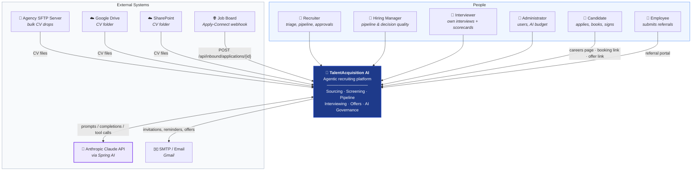
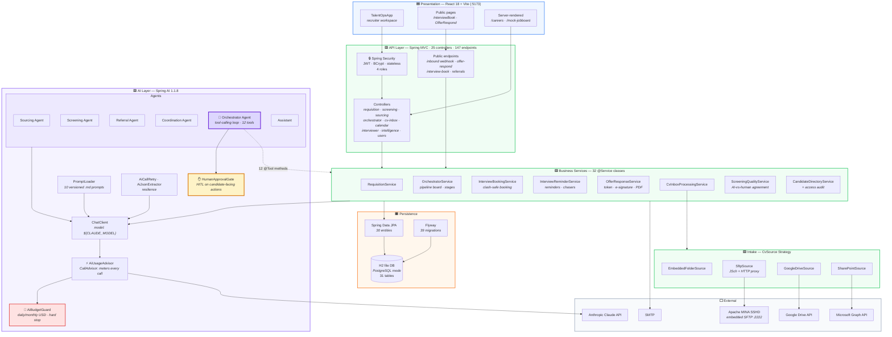
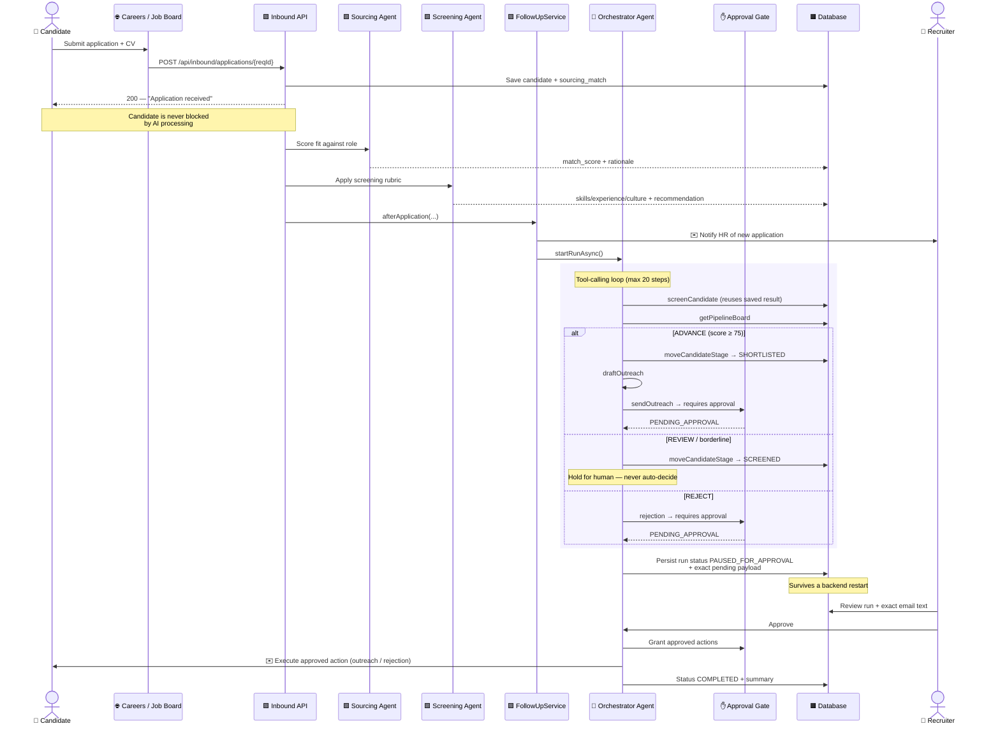
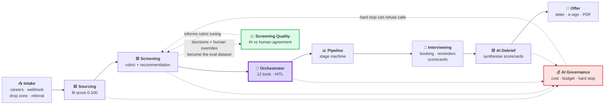
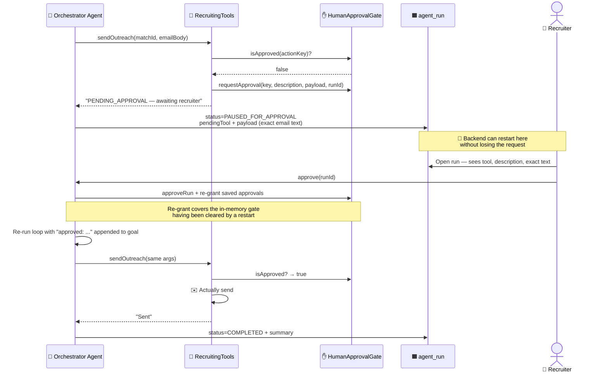
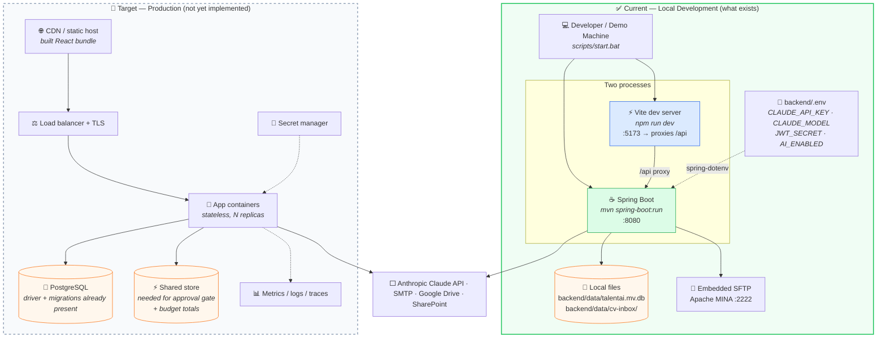

# TalentAcquisition AI — System Architecture

All diagrams below reflect the implementation on branch `feature/spring-ai-refactor`
(HEAD `aa9a560`). Component names map to real packages and classes.

**Consistent colour legend used throughout:**

| Colour | Meaning |
|---|---|
| 🟦 Blue | Frontend / user-facing surfaces |
| 🟩 Green | Backend application & business logic |
| 🟪 Purple | AI agents & LLM components |
| 🟧 Orange | Data & persistence |
| ⬜ Grey | External systems & integrations |

---

## Diagram 1 — System Context

Who uses the system, what it talks to, and where its boundary sits.

**Boundary note:** the platform owns intake, evaluation, coordination and offer execution.
It deliberately does *not* own the hiring decision — that stays with humans at every gated step.

---

## Diagram 2 — High-Level Technical Architecture

### Why these choices

| Decision | Rationale |
|---|---|
| **Modular monolith**, package-by-feature | One deployable, no distributed-transaction cost; feature packages give clean seams if extraction is ever needed |
| **Spring AI** over raw HTTP | Gives `ChatClient`, tool-calling, and the `CallAdvisor` hook that makes cost metering cross-cutting rather than per-call-site |
| **Prompts as versioned `.md` files** | Prompt changes are reviewable in diffs with `last_updated` front-matter — prompts are treated as source, not literals |
| **`CvSource` Strategy** | Adding a 5th channel means one class, not a new pipeline |
| **H2 file + PostgreSQL mode** | Zero-setup demo that runs anywhere; migrations are already Postgres-compatible for the real target |
| **Haiku-class default model** | Screening/extraction are structured-output tasks; cost fell substantially with no measured quality loss on the eval set |

---

## Diagram 3 — User Interaction & Workflow (end-to-end application)

---

## Diagram 4 — Core Feature Interaction

### 4a. How the subsystems depend on each other

**The two dotted feedback loops are the architecturally interesting part:**
every screening decision and every human override becomes training signal for
*Screening Quality*, and every LLM call is metered by *AI Governance* which can refuse
further calls when the budget is exhausted.

### 4b. The HITL approval gate in detail

---

## Diagram 5 — Deployment Architecture

**Honest statement of current state:** the system runs as a local two-process development
deployment. There is no Dockerfile, CI pipeline or cloud manifest in the repository.
The left side is what exists today; the right side is the documented target.

### What must change for production (stated plainly)

| # | Change | Why |
|---|---|---|
| 1 | Remove `permitAll()` on `/api/admin/**` and `/h2-console/**` | Currently unauthenticated — demo convenience, real gap |
| 2 | Move SMTP credentials out of `application.yml` | Only secret still committed in plaintext |
| 3 | Switch datasource to PostgreSQL | Driver and Postgres-mode migrations already in place; low effort |
| 4 | Externalise `HumanApprovalGate` + `AiBudgetGuard` state | Both in-memory per instance; blocks horizontal scaling |
| 5 | Add `@EnableScheduling` or an external scheduler | The 6-hourly resume sync is currently inert by design |
| 6 | Containerise + CI | No Dockerfile or pipeline today |
| 7 | Turn off `demo-mode` | It intentionally relaxes candidate email uniqueness |

---

## Technology Stack (verified against `pom.xml` / `package.json`)

| Layer | Technology |
|---|---|
| Language | Java 21 · JavaScript (ES2022) |
| Backend | Spring Boot 3.3.4 · Spring MVC · Spring WebFlux · Spring Data JPA · Spring Security · Spring Mail |
| AI | Spring AI 1.1.8 (`spring-ai-starter-model-anthropic`) · Anthropic Claude |
| Persistence | H2 (file, PostgreSQL mode) · Flyway 39 migrations · PostgreSQL driver ready |
| Auth | JJWT · BCrypt · stateless JWT |
| File handling | Apache PDFBox (PDF) · direct OOXML read (.docx) · OpenCSV |
| Transfer | Apache MINA SSHD 2.13.2 (embedded SFTP server) · JSch 0.2.21 (SFTP client + HTTP proxy) |
| Frontend | React 18.3 · Vite 5.4 · Tailwind CSS 3.4 · lucide-react · native `fetch` |
| Config | spring-dotenv 4.0 |
| Test | JUnit 5 · Spring Boot Test · Spring Security Test · AssertJ |
